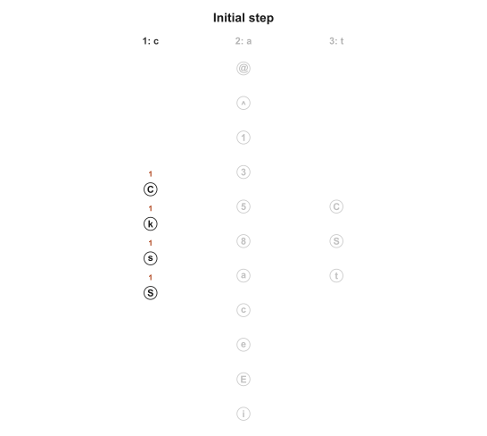
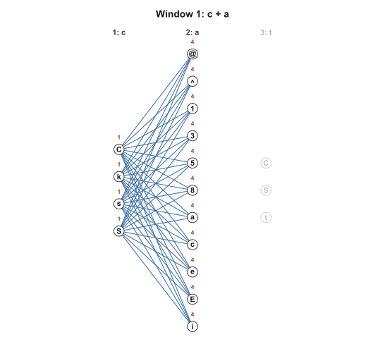
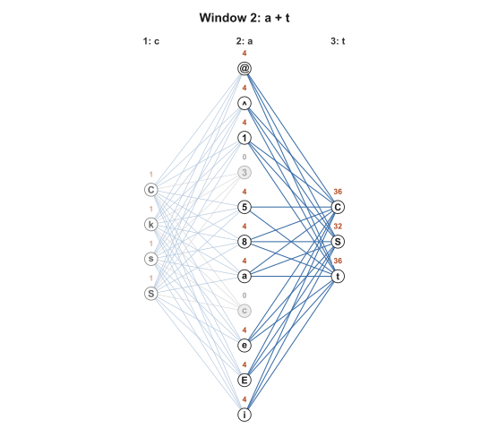
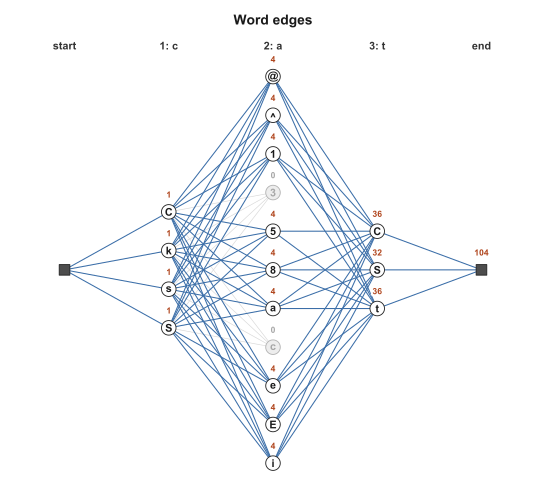
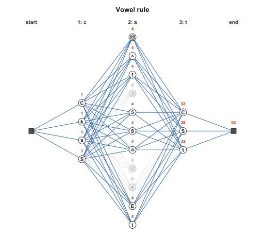

# Sliding-Window Pronunciation Generation

The `pw_read` and `pw_spell` functions generate pronunciations and spellings, respectively, for given inputs by taking the Cartesian product of all possible units (given the grain size constraints, minimum consistency and parsing probability values specified where applicable, etc.). This effectively provides an upper bound on the number of raw "possibilities" given the mappings in the Toolkit, but can result in pronunciations and spellings that are phonotactically or orthotactically impossible. Additionally, for longer words with many constituent units (like "institutionalized"), the number of outputs produced by these functions can run into the billions. Enumerating such an output is practically impossible.

Sliding-window pronunciation generation takes an alternate approach to defining how a "valid" pronunciation or spelling can be formed. At a high level, this algorithm requires that adjacent units within a word have their phoneme or grapheme candidates (depending on the direction) pairwise present somewhere in the lexicon. This is illustrated below.

## Example

The central idea of the Sliding Window algorithm is to take graphemes (or phonemes, if we are interested in the spelling direction, but we will use the reading direction here) pairwise, and advance or "slide" our window of these pairs in order throughout the word, checking if the pair appears in the lexicon. So, given a *parse*, or unit breakdown at the PG level of a word, we start by looking at the first two graphemes.

For the first step of the window, we take all of the phonemes across the lexicon that can be mapped to each of the two graphemes individually. Then, we filter these to only include the pairs that also exist next to each other somewhere in the lexicon, and as we step through, we keep track of the number of "ways" there are to reach the *last* phoneme in the pair we are currently examining. Finally, we make sure that the candidate phonemes for the start and end of the word appear specifically in the word-initial and word-final positions of at least one word in the lexicon, respectively. Take "cat" as an example:

The parse of *cat* is `c` / `a` / `t`. These are the phonemes each grapheme can map to in the Toolkit lexicon (in Toolkit phoneme symbols):

| grapheme | phoneme options | count |
|---|---|---|
| `c` | `C` `k` `s` `S` | 4 |
| `a` | `@` `^` `1` `3` `5` `8` `a` `c` `e` `E` `i` | 11 |
| `t` | `C` `S` `t` | 3 |

Taking every combination, which is what `pw_read` does, gives 4 × 11 × 3 = 132 candidate pronunciations. This algorithm proceeds differently, as follows:

**Initial Step**: We start by assigning 1s to all of the phonemes in the first position `c`, since there are not yet any pairwise restrictions.

**Window 1: `c` + `a`.** For each of the candidate phonemes for `a`, we check if it exists nexts to each of the `c` phonemes somewhere in the lexicon. We then assign a value to that phoneme which is the sum of the values that are assigned to all of the phonemes for the `c` grapheme which are valid here (i.e. exist as a pair with the `a` phoneme). This sum then represents the number of "ways" that the respective phoneme for `a` can be reached so far in the construction.

In this case, all phoneme candidates for `a` exist next to one of the `c` phonemes, so no filtering needs to be done. Then, each phoneme is assigned a value of 4, since for each there are 4 ways the phoneme can be reached up to this point.

**Window 2: `a` + `t`.** The window slides one unit to the right. Now, we take a look at the phonemes of the set for `t` that can come after the options remaning from `a`. Recall that the number of "ways" each of the phonemes for `a` could be reached was 4.

| `a` option | can be followed by | Contributing Total
|---|---|---|
| `@` `^` `1` `8` `a` `e` `E` `i` | `C` `S` `t` | 8 * 4 = 32 for each of `C` `S` and `t` |
| `5` | `C` `t` (not `S`) | 1 * 4 = 4 each for `C` and `t`. 0 for `S`
| `3`, `c` | nothing (in the lexicon these two vowels are always followed by `r`) | N/A

Since `3` and `c` cannot be followed by any of the candidate phonemes for the `t` grapheme, paths that move through them do not reach the end of the word. `5` keeps only two of its three continuations, as above, since it is not followed by the `S` phoneme anywhere in the lexicon.

**Word edges:** The same check is made at the start and end of the word: the first phoneme must begin some word in the lexicon, and the last must be the end of one. For `c` and `t` this is the case for all of the leftover candidates, so nothing else needs to be filtered here.

**Counting and filtering:** A pronunciation contains one phoneme per position of the parse, such that every neighbouring pair satisfies the conditions of the window. To count these without listing them, each phoneme option is given a number: how many valid partial pronunciations end at it. Every option at the first position starts with 1. When the window slides one position to the right, an option's number is the sum of the numbers of the options before it that it is allowed to follow. The total is the sum of the numbers at the last position. For `cat`, every `a` option has all 4 `c` options allowed before it, so each has a value of 4. `C` and `t` each have 9 `a` options allowed before them, and since these 9 options each had 4 "ways" to be reached, `C` and `t` hold a value of 36 (9 × 4 = 36). `S` has 8 valid preceding units and thus has 32 "ways" to be reached (8 × 4 = 32), for a total of 36 + 32 + 36 = 104. We then apply the same validity filters from `pw_read`. For `cat`, the relevant rule to apply is enforcement that schwa is not the only vowel in a pronunciation; for `cat` this removes the 12 that use `e` for the `a` grapheme, leaving **92**.

